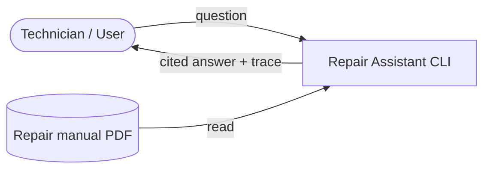
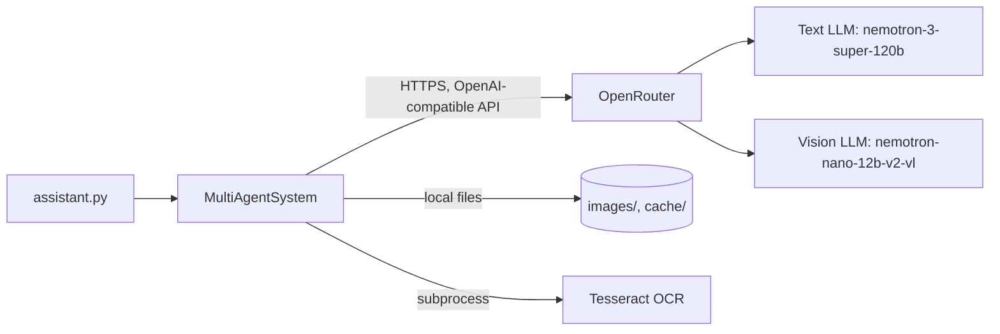
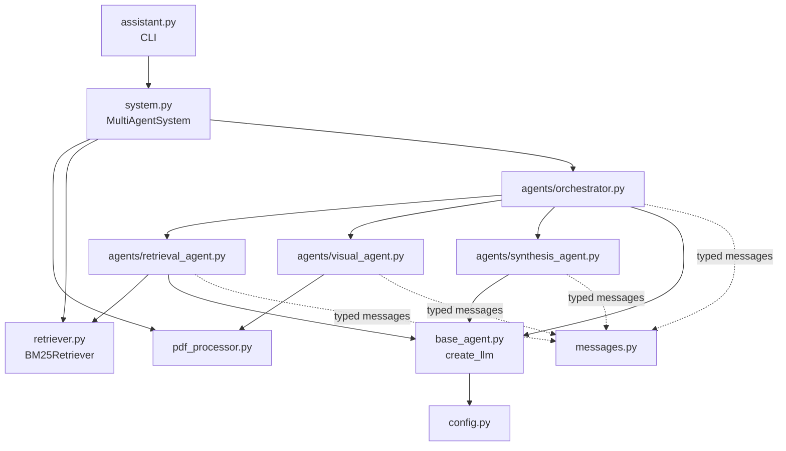
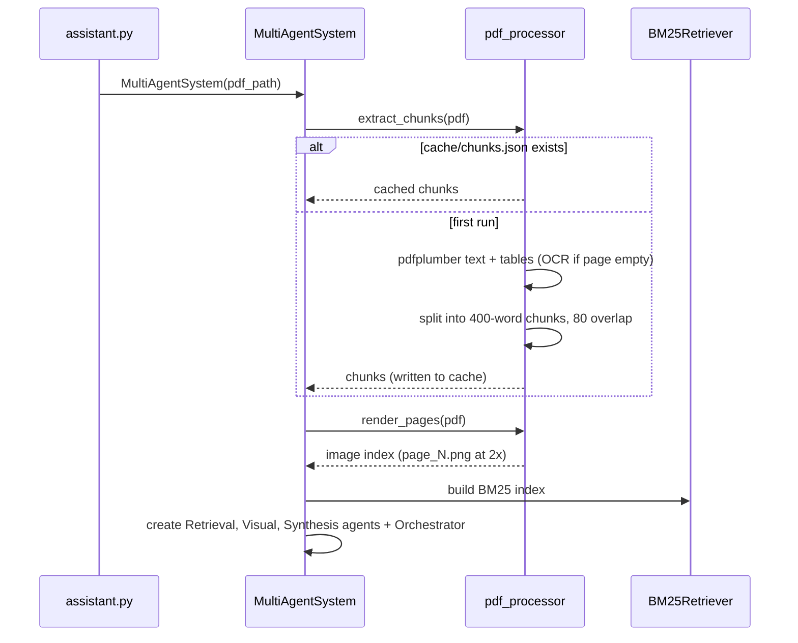
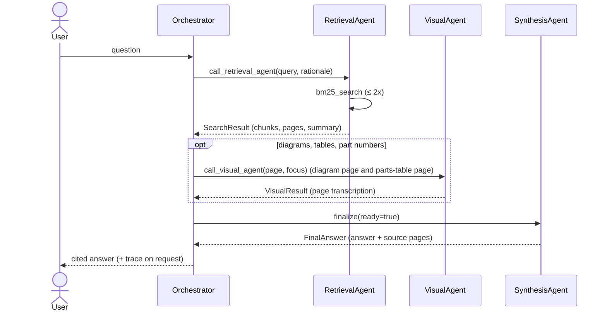
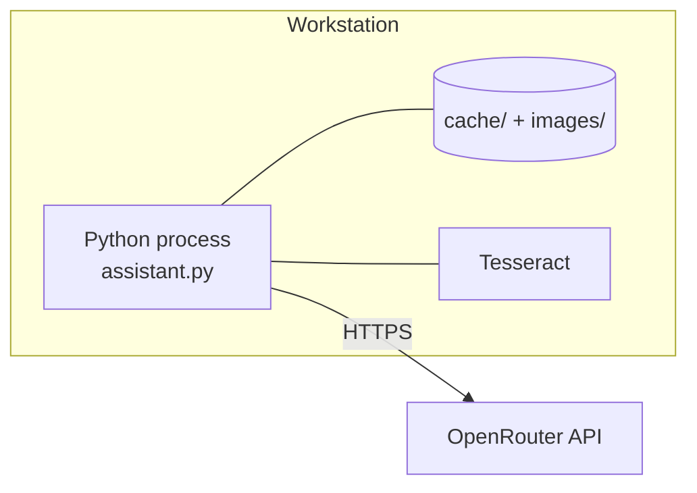

# Repair Assistant — LangChain Multi-Agent System

A command-line assistant that answers questions about a repair manual PDF (built and tested against the *Porsche 911 (993)* manual). A LangChain **orchestrator agent** delegates work to specialised agents for text retrieval, page-image analysis (vision model) and cited-answer synthesis.

This documentation follows the [arc42](https://arc42.org) template.

## Table of contents

1. [Introduction and goals](#1-introduction-and-goals)
2. [Architecture constraints](#2-architecture-constraints)
3. [Context and scope](#3-context-and-scope)
4. [Solution strategy](#4-solution-strategy)
5. [Building block view](#5-building-block-view)
6. [Runtime view](#6-runtime-view)
7. [Deployment view](#7-deployment-view)
8. [Cross-cutting concepts](#8-cross-cutting-concepts)
9. [Architecture decisions](#9-architecture-decisions)
10. [Quality requirements](#10-quality-requirements)
11. [Risks and technical debt](#11-risks-and-technical-debt)
12. [Glossary](#12-glossary)

Quick start: see [Deployment view](#7-deployment-view).

---

## 1. Introduction and goals

### 1.1 Requirements overview

| # | Requirement |
|---|-------------|
| R1 | Answer natural-language questions about a repair manual PDF (procedures, torque values, clearances, part numbers). |
| R2 | Handle both text and visual content (exploded views, diagrams, tables, callouts). |
| R3 | Handle scanned/image-only PDF pages (OCR fallback). |
| R4 | Cite the manual page for every claim. |
| R5 | Support multi-turn conversation in an interactive CLI. |
| R6 | Expose the agent call chain (`trace`) so users can see how an answer was produced. |

### 1.2 Quality goals

| Priority | Goal | Motivation |
|----------|------|------------|
| 1 | **Accuracy / faithfulness** | Wrong torque or clearance values can damage an engine. The system must never invent values. |
| 2 | **Traceability** | Every answer carries page citations and an agent trace. |
| 3 | **Low cost** | Runs on free OpenRouter models; PDF processing is cached. |
| 4 | **Modifiability** | Agents are small, separate modules with typed messages. |

### 1.3 Stakeholders

| Role | Expectation |
|------|-------------|
| Mechanic / technician (end user) | Quick, correct, cited answers from a large manual. |
| Developer / maintainer | Understandable agent boundaries, easy to swap models or retrieval. |

---

## 2. Architecture constraints

| Constraint | Explanation |
|------------|-------------|
| Python 3.10+ | Uses `list[dict]` generics and modern typing. Developed on Windows with Python 3.10. |
| LangChain 0.3.x | `langchain>=0.3,<0.4`, `langchain-openai`, `langchain-community` (see `requirements.txt`). |
| OpenRouter as LLM gateway | All models are reached through the OpenAI-compatible endpoint `https://openrouter.ai/api/v1`. |
| Free-tier models | `nvidia/nemotron-3-super-120b-a12b:free` (text) and `nvidia/nemotron-nano-12b-v2-vl:free` (vision) — subject to rate limits (HTTP 429). |
| Tesseract OCR (optional) | Needed only for PDFs with image-only pages. |
| Local, single-user CLI | No server, no database, no authentication layer. |

---

## 3. Context and scope

### 3.1 Business context



| Partner | Input to system | Output from system |
|---------|-----------------|--------------------|
| User | Natural-language question, CLI commands | Cited answer, agent trace |
| Repair manual PDF | Text, tables, page images | — |

### 3.2 Technical context



| Interface | Technology | Notes |
|-----------|------------|-------|
| User ↔ system | stdin/stdout, ANSI-coloured CLI | Commands: `reset`, `trace`, `help`, `quit`. |
| System → LLMs | HTTPS via `ChatOpenAI` with `base_url=OpenRouter` | Auth with `OPENROUTER_API_KEY`. |
| System → filesystem | JSON + PNG | Chunk cache, image index, rendered pages. |
| System → Tesseract | `pytesseract` | Fallback for pages without native text. |

---

## 4. Solution strategy

| Goal | Approach |
|------|----------|
| Accuracy | Strict "evidence only" prompts in the synthesis and visual agents; low temperature (0.1–0.2); synthesis agent must say "not clearly stated" instead of guessing. |
| Text + visual coverage | Two complementary evidence channels: BM25 text retrieval and vision-model analysis of rendered page images. |
| Separation of concerns | Orchestrator–worker multi-agent pattern: one planner, three specialists. |
| Traceability | Typed dataclass messages between agents; `AgentCall` trace records each delegation. |
| Cost / latency | Cached chunks and page renders; hard limits on retrieval attempts and agent iterations. |
| Scanned pages | pdfplumber first, OCR fallback per page. |

---

## 5. Building block view

### 5.1 Level 1 — whitebox overview



| Building block | Responsibility |
|----------------|----------------|
| `assistant.py` | Interactive CLI loop, argument parsing (`--pdf`), colourised trace output. |
| `system.py` | Composition root: indexes the PDF, builds the retriever, wires the agents. Exposes `ask()` and `reset()`. |
| `pdf_processor.py` | Text/table extraction, OCR fallback, overlapping chunking, page → PNG rendering, JSON caching. |
| `retriever.py` | BM25 index over chunks (wraps LangChain `BM25Retriever`); returns chunks with rank-based score. |
| `agents/orchestrator.py` | Planner. Tool-calling `AgentExecutor` with tools `call_retrieval_agent`, `call_visual_agent`, `finalize`. Keeps multi-turn history. |
| `agents/retrieval_agent.py` | Autonomous tool-calling agent with one tool `bm25_search`; max 2 searches; returns `SearchResult`. |
| `agents/visual_agent.py` | Single multimodal call on a page image; returns `VisualResult`. Retries on HTTP 429. |
| `agents/synthesis_agent.py` | LCEL chain `prompt | LLM | StrOutputParser`; composes the cited answer from all evidence. |
| `base_agent.py` | `create_llm()` factory for `ChatOpenAI` pointed at OpenRouter. |
| `messages.py` | Dataclasses: `SearchTask/Result`, `VisualTask/Result`, `SynthesisTask`, `FinalAnswer`, `AgentCall`. |
| `config.py` | Models, chunking, retrieval, paths; reads `.env`. |
| `test_run.py`, `test_parking_brake.py` | Smoke tests (they call the live LLM and need a PDF). |

### 5.2 Level 2 — agents

| Agent | Type | Tools | Input → Output | Key limits |
|-------|------|-------|----------------|------------|
| OrchestratorAgent | Tool-calling `AgentExecutor` | `call_retrieval_agent`, `call_visual_agent`, `finalize` | question → `(answer, trace)` | `MAX_AGENT_ITERATIONS = 20`; ≤ 2 retrievals, ≤ 2 visual calls (prompt rule) |
| RetrievalAgent | Tool-calling `AgentExecutor` | `bm25_search` | `SearchTask` → `SearchResult` | ≤ 2 searches (prompt), `max_iterations = 10`, top-k = 4 |
| VisualAgent | Direct vision LLM call | — | `VisualTask` → `VisualResult` | `max_tokens = 1200`, 3 attempts on 429 |
| SynthesisAgent | LCEL chain | — | `SynthesisTask` → `FinalAnswer` | `max_tokens = 1800` |

### 5.3 Project layout

```
repair_assistant_langchain/
├── assistant.py          # CLI entry point
├── system.py             # wiring / composition root
├── config.py             # settings
├── base_agent.py         # LLM factory
├── messages.py           # inter-agent message types
├── pdf_processor.py      # extraction, OCR, rendering, caching
├── retriever.py          # BM25 retriever
├── agents/
│   ├── orchestrator.py
│   ├── retrieval_agent.py
│   ├── visual_agent.py
│   └── synthesis_agent.py
├── cache/                # generated: chunks.json, image_index.json
├── images/               # generated: page_N.png
├── requirements.txt
├── .env.example
└── test_run.py / test_parking_brake.py
```

---

## 6. Runtime view

### 6.1 Startup and indexing



### 6.2 Answering a question



### 6.3 CLI commands

| Command | Effect |
|---------|--------|
| *any text* | Ask a question. |
| `trace` | Show agent calls from the last question. |
| `reset` | Clear conversation history. |
| `help` / `quit` | Show commands / exit. |

---

## 7. Deployment view

Single-process local deployment; no servers.



### Setup

```bash
# 1. Create and activate a virtual environment
python -m venv .venv
.venv\Scripts\activate            # Windows  (Linux/macOS: source .venv/bin/activate)

# 2. Install dependencies
pip install -r requirements.txt
pip install pytesseract           # used by pdf_processor.py (see risks)

# 3. Configure
copy .env.example .env            # Linux/macOS: cp .env.example .env
#   set OPENROUTER_API_KEY=sk-or-v1-...
#   set PDF_PATH=path\to\manual.pdf   (optional)

# 4. (Only for scanned PDFs) install Tesseract OCR
#   https://github.com/UB-Mannheim/tesseract/wiki

# 5. Run
python assistant.py --pdf path/to/manual.pdf
```

### Configuration reference (`config.py`)

| Setting | Default | Meaning |
|---------|---------|---------|
| `OPENROUTER_API_KEY` | from `.env` | API key (required). |
| `PDF_PATH` | `../PE_Case_Study_Repair_Manual_Assistant.pdf` | Default PDF when `--pdf` is not given. |
| `TEXT_MODEL` | `nvidia/nemotron-3-super-120b-a12b:free` | Orchestrator, retrieval and synthesis LLM. |
| `VISION_MODEL` | `nvidia/nemotron-nano-12b-v2-vl:free` | Page-image analysis. |
| `CHUNK_SIZE` / `CHUNK_OVERLAP` | 400 / 80 words | Chunking. |
| `TOP_K_CHUNKS` | 4 | Chunks returned per search. |
| `MAX_AGENT_ITERATIONS` | 20 | Orchestrator loop cap. |
| `IMAGE_DPI_SCALE` | 2.0 | Page render zoom. |

> **Cache note:** `cache/` is keyed by nothing — if you switch to a different PDF, delete `cache/` and `images/` first, otherwise the old manual's chunks and images are reused.

---

## 8. Cross-cutting concepts

- **Typed message protocol** (`messages.py`): every delegation and result is a dataclass, making agent boundaries explicit and loggable.
- **Grounded generation**: the synthesis and visual prompts forbid facts not present in the evidence, require page citations, and prefer short accurate answers over complete speculative ones.
- **Bounded autonomy**: iteration caps and prompt rules limit retrieval and visual calls to control cost, latency and rate-limit exposure.
- **Caching**: extracted chunks (`cache/chunks.json`), image index (`cache/image_index.json`) and page PNGs (`images/`) are generated once and reused.
- **Observability**: `AgentExecutor(verbose=True)` logs the reasoning loop; the CLI `trace` command prints the agent call chain.
- **Resilience**: vision calls retry on HTTP 429 with back-off (10 s, 20 s); the retrieval agent builds a fallback summary from raw chunks if it fails to produce one; the orchestrator returns a polite fallback if no final answer was produced.
- **Conversation memory**: the orchestrator keeps `HumanMessage`/`AIMessage` history across turns (`reset` clears it). Sub-agents are stateless per call.
- **Security / secrets**: the API key is read from `.env` (git-ignored). No user data is stored; the question and page content are sent to OpenRouter.

---

## 9. Architecture decisions

| ID | Decision | Rationale | Consequence |
|----|----------|-----------|-------------|
| ADR-1 | **Orchestrator–worker multi-agent design** | Retrieval, vision and writing are distinct skills with different models and prompts. | More LLM calls per question; clearer responsibilities. |
| ADR-2 | **LangChain** (`AgentExecutor`, LCEL, `@tool`) replaces a hand-rolled agent loop | Standard tool-calling loop, less custom code. | Pinned to LangChain 0.3.x (`AgentExecutor` is legacy in newer releases). |
| ADR-3 | **OpenRouter via `ChatOpenAI(base_url=…)`** | One API for many models, free tiers. | Rate limits; model availability can change. |
| ADR-4 | **BM25 keyword retrieval, no embeddings** | Technical manuals contain exact terms (part names, "Nm"); no vector DB or embedding cost. | Misses paraphrases; score is a rank proxy (`1/rank`) because LangChain's BM25 doesn't expose raw scores. |
| ADR-5 | **Render pages as images for a vision model** | Diagrams, exploded views and parts tables lose meaning as text. | Slower, costs vision calls, limited by vision-model quality. |
| ADR-6 | **Dependency injection of sub-agent `run` methods into the orchestrator** | Orchestrator is testable and decoupled from concrete agents. | Wiring lives in `system.py`. |
| ADR-7 | **JSON file cache instead of a database** | Simple, inspectable, zero setup. | No cache invalidation by PDF identity. |

---

## 10. Quality requirements

### 10.1 Quality tree

- **Correctness** → grounded answers → page citations → "not stated in manual" instead of guessing
- **Transparency** → agent trace → verbose executor logs
- **Efficiency** → cached indexing → capped agent iterations
- **Maintainability** → small modules → typed messages → config in one place

### 10.2 Quality scenarios

| ID | Scenario | Expected result |
|----|----------|-----------------|
| Q1 | User asks for a torque value that is not in the manual. | The answer states the value is not clearly stated; no number is invented. |
| Q2 | User asks which part is item *N* in an exploded view. | Orchestrator checks both the diagram page and the parts-table page; answer cites both. |
| Q3 | Second launch with the same PDF. | Startup skips extraction and rendering (cache hit). |
| Q4 | Vision model returns HTTP 429. | Up to 3 attempts with increasing back-off before failing. |
| Q5 | User asks a follow-up ("and for the rear?"). | Conversation history is used by the orchestrator. |
| Q6 | PDF has image-only pages. | OCR fallback produces text chunks; if nothing is extracted, a clear error explains Tesseract is needed. |

---

## 11. Risks and technical debt

| # | Risk / debt | Impact | Suggested mitigation |
|---|-------------|--------|----------------------|
| 1 | `pytesseract` is imported unconditionally in `pdf_processor.py` but missing from `requirements.txt`; the Tesseract path is hard-coded to `C:\Program Files\tesseract.exe`. | Startup fails or OCR breaks on other machines. | Add to requirements; make the path configurable and import lazily. |
| 2 | Cache is not tied to the PDF. | Wrong answers after changing PDFs. | Key the cache by PDF hash/name. |
| 3 | Free-tier models: rate limits, variable tool-calling quality. | Failed or incomplete runs. | Configurable models; retry/back-off on all LLM calls. |
| 4 | Retrieval limits are enforced only by prompt text (not code), except `max_iterations`. | Occasional extra LLM calls. | Enforce counters in the tool closures. |
| 5 | BM25 only; no semantic search. | Paraphrased questions may miss. | Hybrid BM25 + embeddings. |
| 6 | Orchestrator passes only the first 600 chars of the visual description back to itself (full text still reaches synthesis). | Orchestrator may judge evidence on a truncated view. | Pass a summary instead of a fixed cut-off. |
| 7 | Test scripts reference a path (`../repair_assistant_v2/...`) outside this repo, use live LLMs and have no assertions. | Not runnable in CI. | Add mocked unit tests and a fixture PDF. |
| 8 | `sys.path` manipulation and `os.chdir` in `system.py`; `requirements.txt` lists `python-dotenv` twice. | Fragile imports / working directory. | Package the project; clean requirements. |
| 9 | The orchestrator keeps per-turn state on the instance. | Not safe for concurrent use. | Per-request state object if served as a web API. |

---

## 12. Glossary

| Term | Definition |
|------|------------|
| arc42 | Template for architecture documentation. |
| Agent | An LLM that can decide which tools to call in a loop. |
| AgentExecutor | LangChain runtime driving the reason–act loop of a tool-calling agent. |
| BM25 | Keyword ranking function used for text retrieval. |
| Chunk | Overlapping window of 400 words from a manual page. |
| LCEL | LangChain Expression Language (`prompt | llm | parser`). |
| OpenRouter | Gateway offering many LLMs through an OpenAI-compatible API. |
| OCR | Optical character recognition; used for image-only PDF pages. |
| Orchestrator | The agent that plans and delegates to the other agents. |
| Trace | List of sub-agent calls made while answering one question. |
| Vision model | Multimodal LLM that reads page images. |
